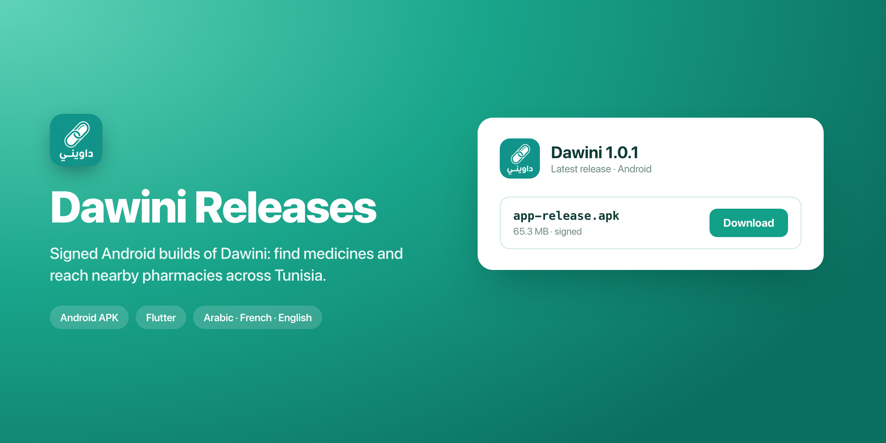

# Dawini Releases

Signed Android builds of [Dawini](https://dawini-pharma.web.app), the app that helps patients in Tunisia find
medicines and reach nearby pharmacies. Patients send a request or a photo of a prescription; verified pharmacies
answer with availability, price and pickup or delivery details.

## Download

Get the latest APK from [Releases](../../releases/latest).

| Version | File | Size |
|---|---|---|
| 1.0.1 | `app-release.apk` | 65.3 MB |

## Install

1. Download `app-release.apk` on your Android phone.
2. Open it and allow installation from this source when Android asks.
3. Launch Dawini and choose Arabic, French or English.

The web version needs no install: [dawini-pharma.web.app](https://dawini-pharma.web.app).
